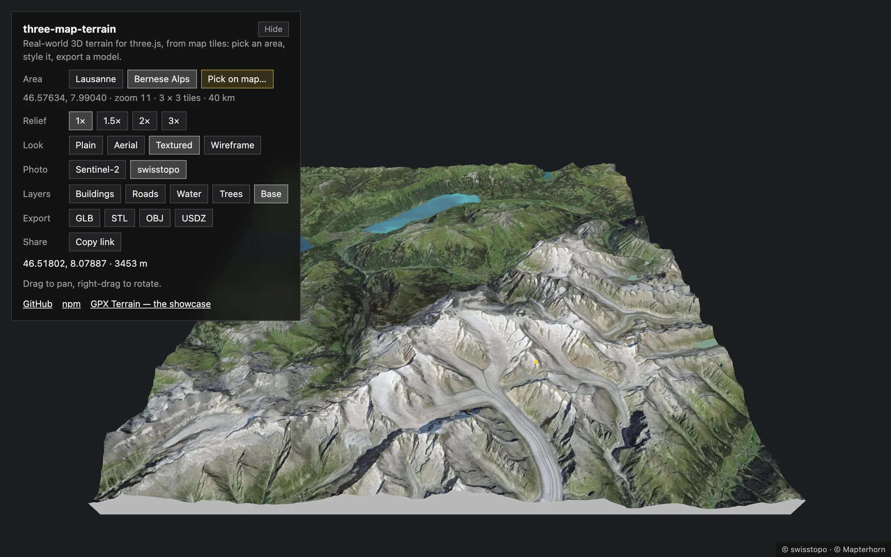
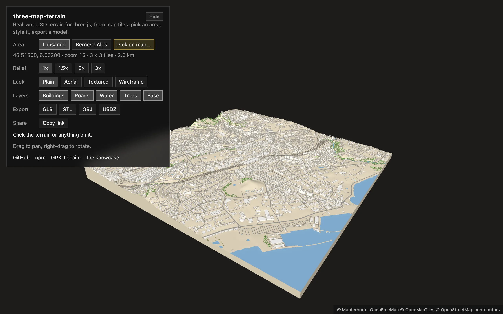
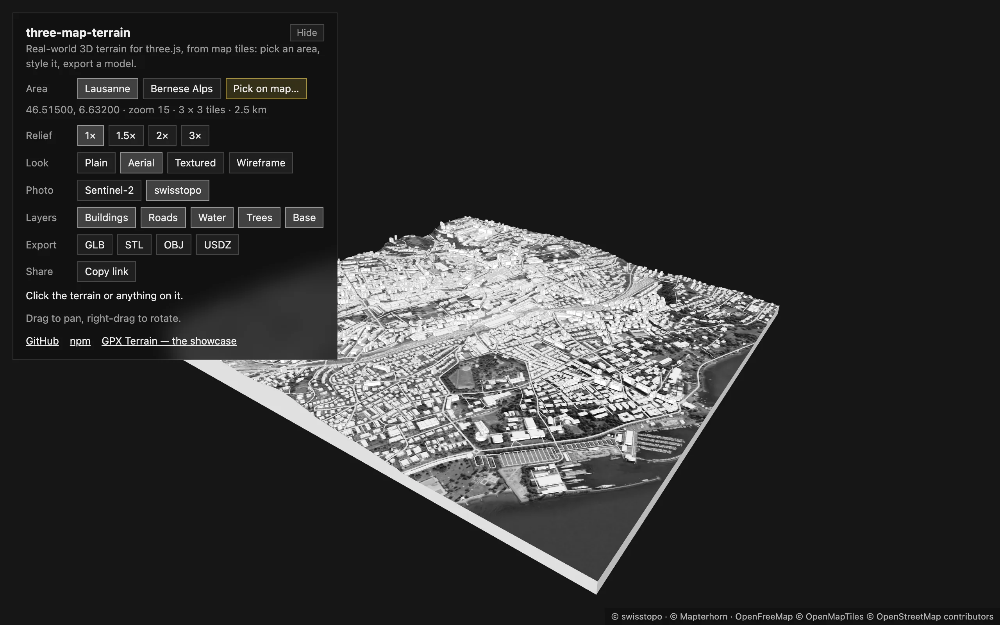
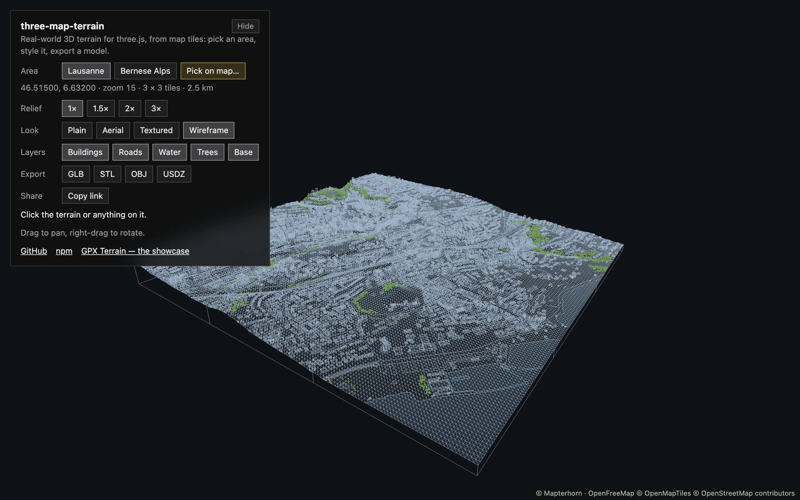

<div align="center">

# three-map-terrain

**Real-world 3D terrain for [three.js](https://threejs.org) from any map tiles — with buildings, roads and bridges, and a frame for your own layers.**<br>
Elevation and imagery from any source, OpenStreetMap buildings standing on the terrain and roads lying exactly on it, the geolocation math to put your data there, and model files — GLB, STL, USDZ — to take it anywhere. Every stage is yours to replace: the data, how it is read, the geometry, the materials.

[](https://www.npmjs.com/package/three-map-terrain)
[](https://github.com/whidrubeld/three-map-terrain/actions/workflows/ci.yml)
[](https://threejs.org)
[](src/index.ts)
[](LICENSE)

[**Documentation**](https://whidrubeld.github.io/three-map-terrain/) · [Live example](https://whidrubeld.github.io/three-map-terrain/examples/react/) · [Getting started](https://whidrubeld.github.io/three-map-terrain/getting-started/) · [Layers](https://whidrubeld.github.io/three-map-terrain/layers/) · [Materials](https://whidrubeld.github.io/three-map-terrain/materials/) · [API](https://whidrubeld.github.io/three-map-terrain/api/map/)

<a href="https://whidrubeld.github.io/three-map-terrain/examples/react/?place=alps"></a>

<table>
  <tr>
    <td width="50%"><a href="https://whidrubeld.github.io/three-map-terrain/examples/react/?place=lausanne&look=plain"></a></td>
    <td width="50%"><a href="https://whidrubeld.github.io/three-map-terrain/examples/react/?place=lausanne&look=textured"></a></td>
  </tr>
  <tr>
    <td><a href="https://whidrubeld.github.io/three-map-terrain/examples/react/?place=lausanne&look=aerial"></a></td>
    <td><a href="https://whidrubeld.github.io/three-map-terrain/examples/react/?place=lausanne&look=wireframe"></a></td>
  </tr>
</table>

<sub>The live example — [a small tool in React Three Fiber](examples/react): any area of the world, picked on an OpenStreetMap map, its layers switched on and off, one map in four looks, exported as GLB, STL, OBJ or USDZ. Every view is a link.</sub>

</div>

## Features

- **Terrain from real elevation** — AWS Terrain Tiles, Mapterhorn, Mapbox, MapTiler or your own, at any zoom, around a location or as any rectangle of tiles.
- **[Buildings](https://whidrubeld.github.io/three-map-terrain/layers/buildings/), [roads and bridges](https://whidrubeld.github.io/three-map-terrain/layers/roads/), [water](https://whidrubeld.github.io/three-map-terrain/layers/water/), [vegetation](https://whidrubeld.github.io/three-map-terrain/layers/vegetation/)** — from OpenStreetMap basemaps, Overpass or your data, standing and lying exactly on the rendered terrain.
- **[Your own layers](https://whidrubeld.github.io/three-map-terrain/own-layers/)** — `FeatureLayer` loads any source's tiles and keeps your geometry in step with the terrain; the built-in layers are made of it.
- **[Any look](https://whidrubeld.github.io/three-map-terrain/materials/)** — your material for every part, UVs in meters, a material factory and a `process` for the imagery.
- **[Any source](https://whidrubeld.github.io/three-map-terrain/sources/)** — presets, `{z}/{x}/{y}` templates, TileJSON or your own `load`; missing tiles cut out of their ancestors.
- **Picking** — the geolocation under the pointer, the feature there, highlighted over any material.
- **[Diorama base and export](https://whidrubeld.github.io/three-map-terrain/export/)** — a solid block; GLB, glTF, OBJ, STL or USDZ, in meters.
- **[Large areas](https://whidrubeld.github.io/three-map-terrain/large-areas/)** — streaming and levels of detail in a few lines, the policy yours; seamless while tiles load.
- **Plain three.js** — built-in materials, `WebGLRenderer` and `WebGPURenderer`; TypeScript, no runtime dependencies, `three` a peer.

## Install

```bash
npm install three three-map-terrain
```

## Quick start

```ts
import { PerspectiveCamera, Scene, WebGLRenderer } from 'three'
import { MapControls } from 'three/addons/controls/MapControls.js'
import { Map } from 'three-map-terrain'

const scene = new Scene()
const camera = new PerspectiveCamera(60, innerWidth / innerHeight, 1, 1e6)
camera.up.set(0, 0, 1) // the terrain lies in the XY plane, Z is up
camera.position.set(0, -1200, 900)

const renderer = new WebGLRenderer({ antialias: true })
renderer.setSize(innerWidth, innerHeight)
document.body.append(renderer.domElement)
const controls = new MapControls(camera, renderer.domElement)

const map = new Map({
  source: { api: 'eox' }, // Sentinel-2 imagery
  location: { lat: 46.57634, lon: 7.9904 } // Bernese Alps
})
scene.add(map.terrain)
await map.init() // geometry is ready; textures keep streaming in

renderer.setAnimationLoop(() => {
  controls.update()
  renderer.render(scene, camera)
})
```

Next: [React Three Fiber, positions on the map](https://whidrubeld.github.io/three-map-terrain/getting-started/), [layers](https://whidrubeld.github.io/three-map-terrain/layers/), [the `Map` API](https://whidrubeld.github.io/three-map-terrain/api/map/) — the [documentation](https://whidrubeld.github.io/three-map-terrain/) has live demos on every page.

## For AI assistants

Every page of the docs is also Markdown — [`llms.txt`](https://whidrubeld.github.io/three-map-terrain/llms.txt), [`llms-full.txt`](https://whidrubeld.github.io/three-map-terrain/llms-full.txt), [more](https://whidrubeld.github.io/three-map-terrain/llms/) — and the [agent skill](https://whidrubeld.github.io/three-map-terrain/skill/) teaches Claude Code, Codex, Cursor and others the library:

```bash
npx skills add whidrubeld/three-map-terrain
```

## Examples

| Example                                                      | Stack                         | What it shows                                                                                                                                                                                        |
| ------------------------------------------------------------ | ----------------------------- | ---------------------------------------------------------------------------------------------------------------------------------------------------------------------------------------------------- |
| [React](examples/react)                                      | React Three Fiber, drei, Vite | [Live](https://whidrubeld.github.io/three-map-terrain/examples/react/): any area picked on a map, every layer switched on and off, four looks at runtime, picking, model export, the view in the URL |
| [Basic](examples/basic)                                      | three.js, webpack             | [Live](https://whidrubeld.github.io/three-map-terrain/examples/basic/): San Francisco, Overture buildings from a custom PMTiles source, OpenFreeMap roads, a base, picking, export                   |
| [**GPX Terrain**](https://github.com/whidrubeld/gpx-terrain) | React, R3F, TanStack Store    | [A full app](https://whidrubeld.github.io/gpx-terrain/) on the library: GPX tracks draped on terrain, profile, playback, picking, imagery and wireframe at runtime                                   |

## Data and attribution

Show the credits of the data you use — `map.attributions` lists them — and follow its terms: [the presets' licenses](https://whidrubeld.github.io/three-map-terrain/attribution/).

## Development

```bash
pnpm install    # the library, docs/ and the examples (one pnpm workspace)
pnpm dev        # playground with hot reload on http://localhost:5173
pnpm validate   # typecheck, lint, format check, unit tests, build
pnpm test:e2e   # rendering tests in Chromium (WebGL + WebGPU), tile servers mocked
```

The documentation is [`docs/`](docs) — Astro Starlight, a package of the workspace: `pnpm build` here, then `pnpm dev` there. The playground takes query parameters: `renderer=webgpu` (`&forceWebGL=1` for its WebGL2 backend), `lights=0`, `wireframe=1`, `segments=40`, `nTiles=5`, `grid=0,-1,1,1` (any rectangle, in tiles from the location's), `view=top`, `api=osm|swisstopo|none`, `color=e9e4da`, `gray=1` (a `process`), `elevation=mapterhorn`, `buildings=openfreemap&edges=1`, `roads=openfreemap`, `water=openfreemap`, `vegetation=openfreemap`, `zoom=15&lat=46.515&lon=6.632`, `base=372`, `lod=2&skirt=400` (levels of detail), `stream=1`. Architecture notes and conventions are in [AGENTS.md](AGENTS.md).

## License

[MIT](LICENSE)
